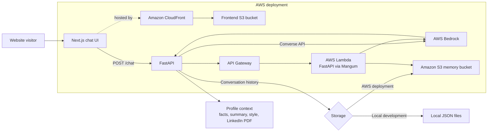

# AI Digital Twin

This project is a conversational digital twin for Subham Das. It gives website visitors an AI chat experience grounded in curated professional profile information, including a facts file, career summary, communication-style notes, and LinkedIn profile. A Next.js frontend talks to a FastAPI backend, which uses AWS Bedrock to generate responses and stores conversation history locally during development or in Amazon S3 when deployed.

## Architecture



In the deployed design, Terraform provisions the frontend bucket and CloudFront distribution, an API Gateway HTTP API and Lambda function, and an S3 bucket for conversation memory. The deployment scripts currently have issues documented under [Deployment review](#deployment-review); the diagram describes the intended topology.

## Project structure

- `frontend/` — Next.js and React chat interface.
- `backend/` — FastAPI application, Bedrock integration, Lambda adapter, and deployment-package builder.
- `backend/data/` — Profile facts, communication style, and LinkedIn PDF used to construct the model context.
- `terraform/` — AWS infrastructure definitions and environment variables.
- `scripts/` — PowerShell and shell deployment/destruction scripts.

## Run locally

### Requirements

- Python 3.12 or newer
- [uv](https://docs.astral.sh/uv/)
- Node.js and npm
- AWS credentials with permission to invoke the configured Bedrock model

### Start the backend

From the repository root:

```powershell
cd backend
uv sync
uv run uvicorn server:app --reload
```

The backend listens at `http://localhost:8000`. It loads optional settings from `backend/.env`; the defaults use local JSON conversation storage and the `us-east-1` AWS region. Local model responses still require valid AWS credentials and access to the selected Bedrock model.

| Backend setting | Default | Description |
| --- | --- | --- |
| `DEFAULT_AWS_REGION` | `us-east-1` | AWS region for the Bedrock runtime client. |
| `BEDROCK_MODEL_ID` | `global.amazon.nova-2-lite-v1:0` | Bedrock model used for chat responses. |
| `CORS_ORIGINS` | `http://localhost:3000` | Comma-separated list of allowed frontend origins. |
| `USE_S3` | `false` | Set to `true` to store conversation history in S3. |
| `S3_BUCKET` | Empty | S3 bucket name; required when `USE_S3=true`. |
| `MEMORY_DIR` | `../memory` | Local conversation storage directory, relative to the backend working directory. |

### Start the frontend

In a second terminal:

```powershell
cd frontend
npm ci
npm run dev
```

Open `http://localhost:3000`. The frontend defaults to the local API at `http://localhost:8000`. To use another API URL, set `NEXT_PUBLIC_API_URL` in `frontend/.env.local` before starting or building the frontend:

```dotenv
NEXT_PUBLIC_API_URL=http://localhost:8000
```

## API

- `GET /` — API and model information.
- `GET /health` — Basic health and storage configuration.
- `POST /chat` — Sends a message and returns the assistant response and conversation session ID.
- `GET /conversation/{session_id}` — Retrieves a stored conversation.

Example request:

```json
{
  "message": "Tell me about your experience with generative AI."
}
```

Pass the returned `session_id` in later `/chat` requests to continue the same conversation. The interactive API documentation is available at `http://localhost:8000/docs` while the backend is running.

## Profile and prompt data

The backend assembles the digital-twin prompt from `backend/data/facts.json`, `backend/summary.txt`, `backend/data/style.txt`, and text extracted from `backend/data/linkedin.pdf`. Update those files to change the profile information or response style. Keep personal data current and only include information that should be used by the public-facing application.

## AWS infrastructure and deployment

Terraform configuration is in `terraform/`. The AWS deployment uses Lambda with the `python3.12` runtime, API Gateway, Bedrock, S3 conversation storage, and CloudFront for the website. Terraform can optionally configure a Route 53 domain and an ACM certificate when `use_custom_domain` is enabled. AWS credentials, Bedrock model access, and any remote Terraform state resources must be configured before deployment.

`backend/deploy.py` builds the Lambda deployment archive. The deployment scripts are `scripts/deploy.ps1` and `scripts/deploy.sh`; review the known gaps below before using them.

### Deployment review

- `scripts/deploy.sh` currently contains PowerShell syntax rather than a Bash deployment script.
- `scripts/deploy.ps1` requests Terraform outputs named `frontend_url` and `legacy_s3_memory_bucket`, but neither output is defined in `terraform/`.
- The PowerShell deployment script syncs a Next.js `out/` directory to S3, but `frontend/next.config.ts` does not enable static export, so a standard Next.js build does not produce that directory.
- The PowerShell deployment/destruction scripts and Bash destruction script pass S3 backend settings to `terraform init`, but the Terraform configuration does not declare an S3 backend.

These issues should be resolved and the deployment flow tested before treating the scripts as a working production deployment.
